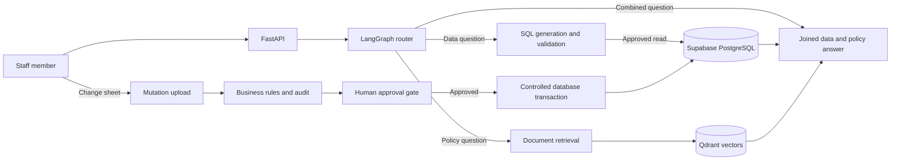

# IDOP — E-commerce Data and Policy Assistant

[](https://github.com/Manishekhar001/IDOP/actions/workflows/ci.yml)
[](https://github.com/Manishekhar001/IDOP/actions/workflows/cd.yml)

**Bring e-commerce data and operating guidance together in one staff-facing assistant.** Ask questions in everyday language, find relevant policy guidance, and prepare supported spreadsheet updates for review.

IDOP combines natural-language data access, document search, and controlled data maintenance through a FastAPI service. Python dependencies are managed with [uv](https://docs.astral.sh/uv/) and pinned by the committed `uv.lock`.

## Business workflows

- **See business operations clearly.** Ask about customers, product inventory, and order status using relational data.
- **Find guidance quickly.** Search returns, shipping, inventory, and other documents in natural language.
- **Connect the answer to the policy.** Combine a data question with a document question, such as checking low stock alongside replenishment guidance.
- **Make routine updates with oversight.** Upload a supported spreadsheet, review the proposed changes, and approve validated updates through the application.

| Need | Example question or action |
| --- | --- |
| Customer overview | “How many customers are in each segment?” |
| Inventory review | “Which products have fewer than 20 units in stock?” |
| Order monitoring | “How many orders are delivered, processing, or pending?” |
| Policy guidance | “What does the returns guide say about damaged items?” |
| Combined insight | “Show low-stock products and summarize the sample replenishment guidance.” |
| Catalog maintenance | Upload a supported product update sheet, review the proposed changes, and approve it. |

## How it works

1. A staff member asks a question or uploads a supported change sheet.
2. IDOP routes the request to the relevant data, document, or combined workflow.
3. Data questions use guarded, read-only SQL over PostgreSQL. Document questions retrieve relevant passages from Qdrant.
4. Spreadsheet changes are checked against configured business rules and shown for approval before they are applied.

## Architecture tied to the business workflow

| Staff need | Application path | Business control |
| --- | --- | --- |
| Ask about customers, stock, or orders | FastAPI → LangGraph routing → SQL generation and validation → PostgreSQL | Read-only SQL is checked before it can be approved and executed. |
| Find operating guidance | FastAPI → LangGraph retrieval → Qdrant → answer with retrieved context | Source passages ground answers in the indexed policy documents. |
| Combine data and guidance | Router combines the SQL and document paths | One response can connect a current data result with relevant policy context. |
| Update the product catalog | Spreadsheet upload → mapping and business rules → audit → approval gate → transaction | Changes are staged for review; an authorized approval is required before execution. |



## Deployment

The production path is part of the project: GitHub Actions runs CI, builds the locked production image, publishes it to Amazon ECR, and deploys it to AWS EC2 with Docker Compose. The service runs as a non-root user behind Nginx. Supabase PostgreSQL holds business records, Qdrant holds document vectors, and the Compose-managed PostgreSQL service holds application checkpoint state.

### Continuous deployment

The repository's CI/CD workflows provide the release path:

1. A push or pull request to `main` starts [Continuous Integration](.github/workflows/ci.yml), which syncs the locked environment with `uv`, checks Ruff and Black across the application, tests, and scripts, runs the offline test suite, reports coverage, and builds the Docker image.
2. A successful **push** to `main` triggers [Continuous Deployment](.github/workflows/cd.yml). CD checks out the exact commit that passed CI, builds the production image from the Dockerfile, and publishes it to ECR. Pull request runs never deploy.
3. The workflow connects to EC2 over SSH, prepares the Docker Compose deployment and runtime environment, then starts the new image.
4. The deployment checks the application health endpoint and attempts to restore the previous stable image if the new container does not become healthy.

#### First deployment setup

1. In the target AWS account, create the ECR repository: `aws ecr create-repository --repository-name idop-app --region us-east-1`. The account needs ECR push access; the workflow builds and pushes a `linux/amd64` image.
2. Prepare an x86_64 Ubuntu EC2 host with an `ubuntu` SSH account. The workflow installs Docker Compose and Nginx, then deploys the service. Allow SSH from the deployment runner and web traffic on ports 80/443 as needed; keep the app's port 8000 behind Nginx.
3. In **GitHub → Settings → Secrets and variables → Actions**, add `AWS_ACCESS_KEY_ID`, `AWS_SECRET_ACCESS_KEY`, `ECR_REGISTRY` (for example, `<account>.dkr.ecr.us-east-1.amazonaws.com`), `EC2_HOST`, and `EC2_SSH_KEY` (the private key contents).
4. Add the application secrets required by your configuration, including `JWT_SECRET_KEY`, `SUPABASE_DB_URL`, `QDRANT_URL`, `QDRANT_API_KEY`, and the selected model and embedding provider keys. `DOMAIN_NAME` is optional and enables HTTPS setup. The [CD workflow](.github/workflows/cd.yml) documents all supported variables and secrets.

Keep credentials in GitHub Secrets, not in the repository. After the first successful push to `main`, follow the CD workflow run and confirm its post-deployment `/health` check passes.

After deployment, use the configured application domain or host and check `/health`; the interactive API documentation is available at `/docs`.

### Build the production image locally

The Dockerfile installs the exact application dependency versions from `uv.lock` using `uv sync --locked`:

```bash
docker build --build-arg GIT_COMMIT_SHA=$(git rev-parse HEAD) -t idop-app:local .
```

The production container runs as a non-root user and starts the API with Uvicorn.

## GitHub delivery and initial metrics

The badges at the top show the latest CI and deployment workflow status. Every CI run publishes a GitHub Actions summary with the test counts and application line coverage, and stores the JUnit and coverage reports as downloadable artifacts for 14 days. The CI run also reports Ruff, Black, and Docker build results. Coverage starts as a measured baseline; the workflow does not claim an arbitrary target or block releases on one.

For runtime evaluation, API responses expose request processing time. Opik can record workflow traces when configured, and the assistant can return answer relevancy, faithfulness, and context-precision scores when RAG evaluation is enabled. These are application signals, while the CI summary measures code and release health. The included synthetic demo contains 8 customers, 10 products, 20 orders, and 3 policy documents; those sample counts are not production business KPIs.

## Run a synthetic demo

Fictional e-commerce records and sample policies are included so the workflows can be explored without importing real customer data:

- 8 customers, 10 products, and 20 orders in [`demo_data/`](demo_data/).
- Sample returns, shipping, and inventory/pricing guidance in [`demo_data/policies/`](demo_data/policies/).
- The seed command writes rows to PostgreSQL and indexes policy documents in the dedicated Qdrant collection `idop_demo_documents`.

The sample supports customer, inventory, order-status, order-total, and general policy questions. Policy text is illustrative; order records contain totals and statuses rather than item-level order lines or delivery events.

### 1. Configure demo services

You need Python 3.11+, a dedicated demo PostgreSQL database (including Supabase), a Qdrant cluster, and credentials for the configured language-model and embedding providers.

Copy `.env.demo.example` to `.env` and fill in the demo service credentials. Set `DATABASE_URL`, `SUPABASE_DB_URL`, and `IDOP_DEMO_DATABASE_URL` to the same dedicated demo database. Set `QDRANT_URL` and `QDRANT_API_KEY` for your demo Qdrant cluster, and keep `COLLECTION_NAME=idop_demo_documents` so the app reads the seeded policy vectors.

For local PostgreSQL, start the included database service with `docker compose up -d postgres`. The seed command inserts the synthetic rows once into an empty demo database and records its dataset marker.

### 2. Sync, seed, and start

Install the project and development tools from the lockfile:

```bash
uv sync --locked --extra dev
uv run python scripts/seed_demo_data.py
uv run python run.py
```

To seed only the relational data, run `uv run python scripts/seed_demo_data.py --database-only`. Open [http://localhost:8000/docs](http://localhost:8000/docs) to explore the API; register or sign in before calling protected routes.

## Technology

- **FastAPI** for the API and authentication.
- **PostgreSQL / Supabase** for relational business records and application state.
- **Qdrant** for document search.
- **LangGraph and language-model providers** for routed assistant workflows.
- **uv and `uv.lock`** for locked Python dependency management in local setup, CI, and the production image.
- **Business rules and approval routes** for spreadsheet-assisted updates.

## Project structure

```text
app/                 API, authentication, assistant workflows, SQL and document services
business_rules/      Validation rules for supported spreadsheet changes
demo_data/            Fictional business records and sample policy documents
scripts/              Database utilities and demo data seeding
tests/                Automated test suite
.github/workflows/    CI and AWS deployment workflows
```

## Local quality checks

```bash
uv run ruff check app/ tests/ scripts/
uv run black --check app/ tests/ scripts/
uv run pytest tests/ -v --tb=short --cov=app --cov-report=term-missing
```

Keep provider credentials in `.env` locally and use GitHub Actions secrets for deployment.
